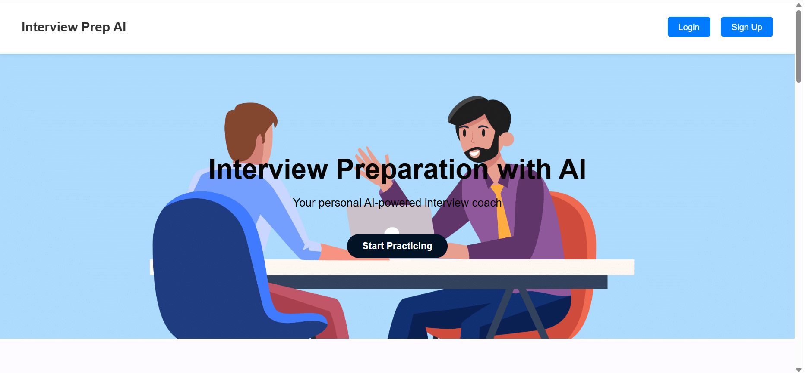
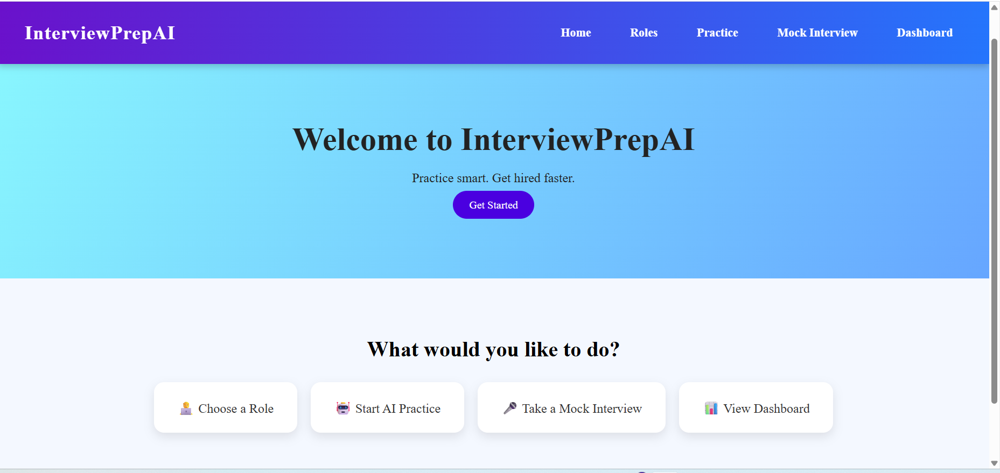
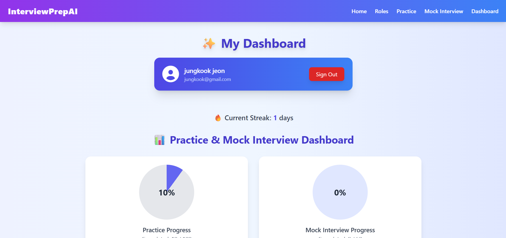
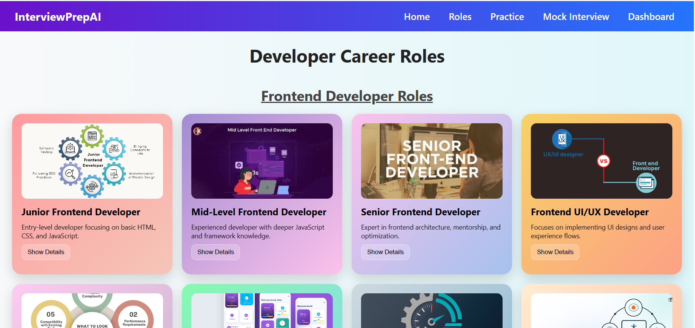
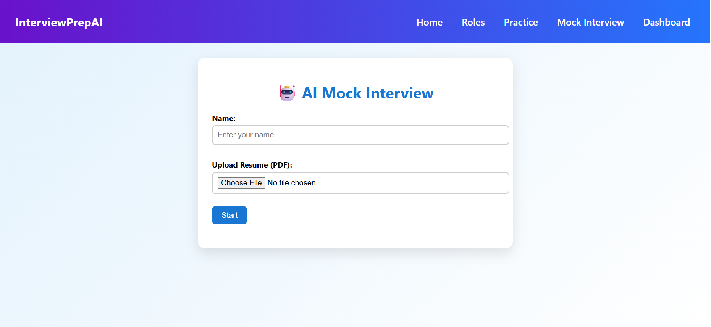
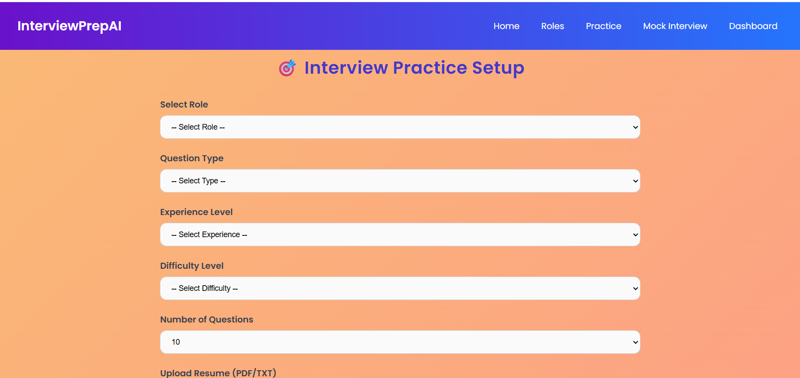
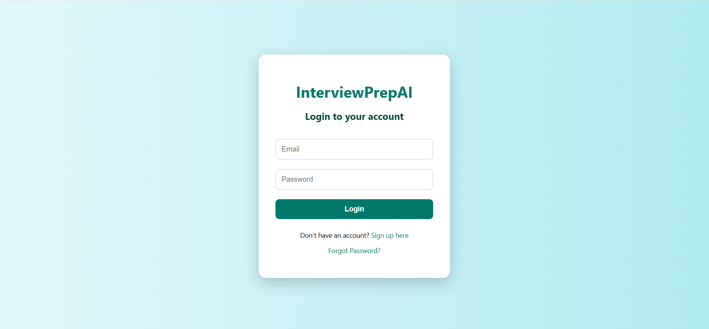
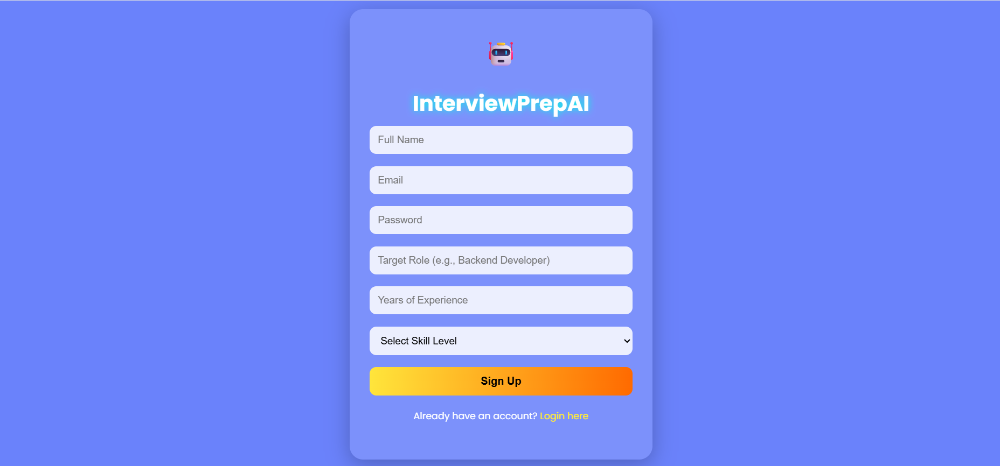

# AI Interview Preparation Tool

An AI-powered interview preparation platform designed to help candidates improve their technical knowledge and interview skills through practice questions and mock interviews.

## About the Project

The AI Interview Preparation Tool provides an interactive platform where users can explore interview questions, practice technical interviews, and track their preparation progress.

It integrates Google's Gemini API to generate AI-powered interview content.

## Features

- User Registration and Login
- AI-powered Interview Question Generation
- Mock Interview Practice
- Multiple Technical Roles and Topics
- Interview Preparation Dashboard
- User Progress Tracking
- Practice History and Performance Summary

## Technologies Used

**Frontend**
- HTML5
- CSS3
- JavaScript

**Backend**
- Node.js
- Express.js

**Database**
- MongoDB
- Mongoose

**AI Integration**
- Google Gemini API

## Application Screenshots

### Main Page


### Home Page


### Dashboard


### Developer Roles


### Mock Interview


### Interview Practice


### Login Page


### Signup Page


## Project Structure

```text
AI-Interview-Preparation-Tool/
├── Main/
│   ├── Dashboard/
│   ├── Mock-Interview/
│   ├── Roles/
│   └── interview-questions-ai/
├── images/
│   ├── backend/
│   ├── frontend/
│   ├── other/
│   └── output/
│       ├── main-page.png
│       ├── home.png
│       ├── dashboard.png
│       ├── roles.png
│       ├── mock-interview.png
│       ├── practice.png
│       ├── login.png
│       └── signup.png
├── singup/
├── index.html
├── script.js
├── style.css
├── server.js
├── package.json
├── package-lock.json
├── .gitignore
└── README.md
```

## Installation and Setup

### 1. Clone the Repository

```bash
git clone https://github.com/Srilakshmi-171/AI-Interview-Preparation-Tool.git
```

### 2. Navigate to the Project Directory

```bash
cd AI-Interview-Preparation-Tool
```

### 3. Install Dependencies

```bash
npm install
```

### 4. Configure Environment Variables

Create a `.env` file in the project root directory and add your Gemini API key:

```env
GEMINI_API_KEY=your_gemini_api_key
```

Make sure your MongoDB server is running and that the connection settings in `server.js` match your environment.

**Important:** Never upload your `.env` file or expose your API key publicly.

### 5. Start the Backend Server

```bash
node server.js
```

The backend server runs on port `5000`.

### 6. Open the Application

Open `index.html` in your browser to access the frontend.

## Future Enhancements

- Advanced interview performance analytics
- Improved AI-based answer evaluation
- Additional technical interview categories
- Enhanced user experience and interface

## Author

**Srilakshmi**

GitHub: [Srilakshmi-171](https://github.com/Srilakshmi-171)

## GitHub Repository

[AI Interview Preparation Tool](https://github.com/Srilakshmi-171/AI-Interview-Preparation-Tool)
